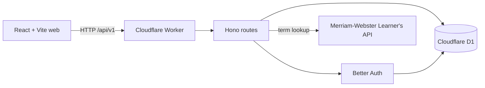

# 系統架構

## Monorepo

根目錄以 pnpm workspace 管理，workspace pattern 在 [`pnpm-workspace.yaml`](../pnpm-workspace.yaml)：

| Package           | 職責                                            | 現況                                            |
| ----------------- | ----------------------------------------------- | ----------------------------------------------- |
| `apps/web`        | React 19、Vite 前端                             | 仍是 Vite 範例 UI；尚未串接 API    |
| `apps/api`        | Hono API、Better Auth、OpenAPI、Wrangler Worker | 已有初版 REST API 與 D1 migrations              |
| `packages/shared` | 預期放前後端共用型別／工具                      | 目前尚無實際 exports                            |

根目錄 `dev` script 會平行啟動有 `dev` script 的 workspace package；`build`、`lint`、`typecheck` 同樣由 workspace scripts 組成。根目錄 lint 設定見 [`.oxlintrc.json`](../.oxlintrc.json)，共用 TypeScript 預設見 [`tsconfig.base.json`](../tsconfig.base.json)。

## Runtime 架構

本機 web 預設使用 Vite port 4173（若已被占用會自動選下一個可用 port）；API Wrangler 開發伺服器預設 port 8787。本機 API 使用 Wrangler local D1。

## 重要程式碼位置

- Worker entry 與 app-level middleware：[`apps/api/src/index.ts`](../apps/api/src/index.ts)、[`apps/api/src/middleware/`](../apps/api/src/middleware/)。
- API 路由按 `/api/v1` resource 分檔：[`apps/api/src/routes/v1/`](../apps/api/src/routes/v1/)；HTTP handlers 位於 [`apps/api/src/controllers/`](../apps/api/src/controllers/)。
- Drizzle 查詢 model/repository 位於 [`apps/api/src/models/`](../apps/api/src/models/)；domain schema 位於 [`apps/api/src/db/schema/`](../apps/api/src/db/schema/)。
- OpenAPI 文件：[`apps/api/src/openapi/document.ts`](../apps/api/src/openapi/document.ts)。
- Better Auth 設定：[`apps/api/src/auth.ts`](../apps/api/src/auth.ts)。
- Worker environment/binding 型別：[`apps/api/src/env.ts`](../apps/api/src/env.ts)。
- Worker、D1 binding 和 migrations 路徑：[`apps/api/wrangler.jsonc`](../apps/api/wrangler.jsonc)。
- Drizzle schema 與產生後的 D1 SQL migrations：[`apps/api/src/db/schema/`](../apps/api/src/db/schema/)、[`apps/api/migrations/`](../apps/api/migrations/)。
- 本機 Unicode 路徑下的 Wrangler persistence workaround：[`apps/api/scripts/wrangler.mjs`](../apps/api/scripts/wrangler.mjs)。

每個 route 把 HTTP method/path 導向對應 controller；controller 處理 HTTP 驗證和回應，model 封裝 Drizzle 資料存取。新增或調整 route 時需同步更新 OpenAPI 文件。
