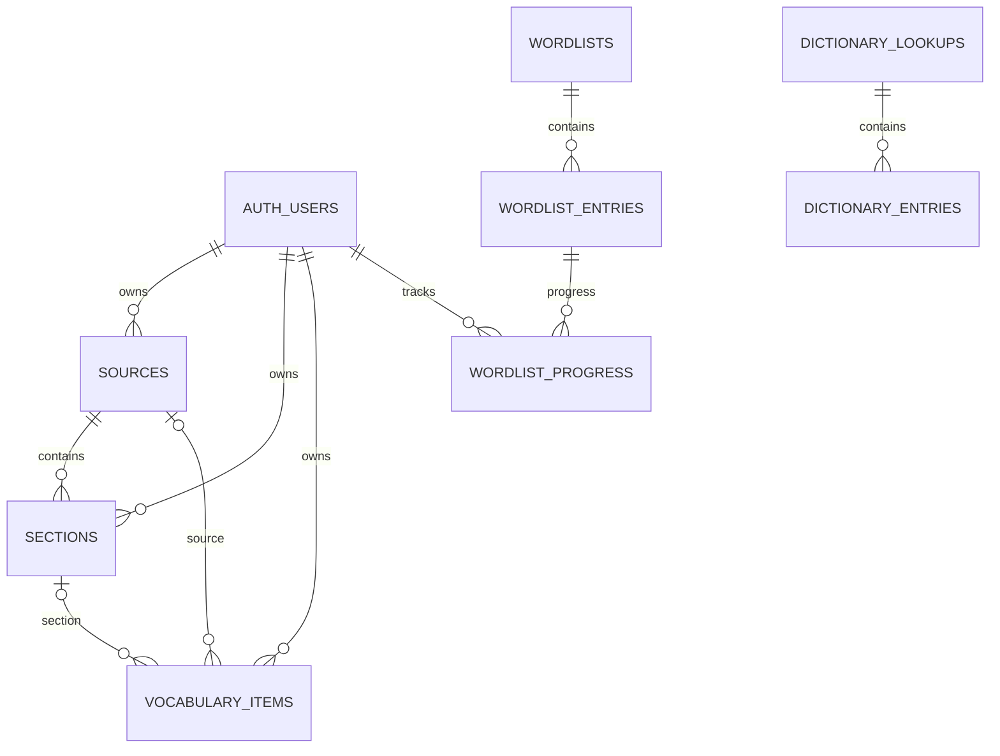

# D1 資料模型

Drizzle schema 依 domain 分組在 [`apps/api/src/db/schema/`](../apps/api/src/db/schema/)，這是 schema 定義的 source of truth。Drizzle Kit 會據此產生 SQL migrations，輸出到 [`apps/api/migrations/`](../apps/api/migrations/)：

- `0000_auth.sql`：Better Auth tables 與 bootstrap state。
- `0001_vocabulary.sql`：sources、sections、vocabulary items。
- `0002_dictionary.sql`：dictionary lookup 與淺層 entry 索引。
- `0003_wordlists.sql`：wordlists、entries 與使用者 progress。
- `0004_auth_query_indexes.sql`：auth account/session user lookup 與 verification identifier indexes。
- `0005_dictionary_normalized_json.sql`：在 dictionary lookup 加入 adapter 產生的 normalized JSON。
- `0006_dictionary_permanent_lookups.sql`：移除 dictionary lookup 的自動過期欄位。

Migration 檔案依序執行，因此建立 foreign key 所依賴的 `auth_users` 在第一個 migration。初始 schema 尚未部署到正式資料庫；目前是按領域逐步生成初始 migrations。完成首次部署後，migration 就是已發佈的變更歷史：不要重排或修改已套用的 migration，未來修改 Drizzle schema 後，產生下一個序號 migration。

應用程式的資料讀寫透過 `drizzle-orm/d1` query builder；controller 與 model 不直接拼 SQL。Migration 輸出仍是 SQL，因為這是 D1/Wrangler 套用資料庫結構變更的格式。

## 關係概覽

Dictionary lookup/entry 關係以 `provider + term/lookup_term` 作應用層關聯，正規化 entries 表沒有資料庫 foreign key。

Dictionary lookup 永久保留 provider 原始 response 與 adapter 產生的 `normalized_json`。查到紀錄時直接回傳 normalized JSON，不再呼叫 Webster 或重跑 adapter；既有尚未有 normalized JSON 的資料會從原始 response 轉換並補存。只有查無紀錄時才呼叫 Webster。`dictionary_entries` 仍作為淺層索引。

## 資料表職責

| Table                | 用途／關鍵欄位                                                                                                  |
| -------------------- | --------------------------------------------------------------------------------------------------------------- |
| `auth_users`         | Better Auth 使用者；含 `email`、`role`、封鎖欄位。                                                              |
| `auth_sessions`      | 登入 sessions、token、到期時間與 user 關聯。                                                                    |
| `auth_accounts`      | Credential provider 與密碼 hash 等 account 資料。                                                               |
| `auth_verifications` | Better Auth verification records。                                                                              |
| `sources`            | 使用者來源；`user_id` 所有權隔離。                                                                              |
| `sections`           | 必須隸屬一個 source；含可選排序 `position`。                                                                    |
| `vocabulary_items`   | 個人單字／片語、notes、狀態、可選 `source_id` 和 `section_id`。                                                 |
| `dictionary_lookups` | Provider 原始 response、清洗後的 `normalized_json`，以及首次抓取時間；不自動過期。                                    |
| `dictionary_entries` | 由 Webster Learner adapter 建立的淺層索引：headword、詞性、第一筆發音（MW notation 或 IPA）、音檔名稱、short definitions；另保留單筆 `entry_json`。完整 response 保存在 `dictionary_lookups`。 |
| `wordlists`          | 獨立詞表 metadata；不綁定使用者。                                                                               |
| `wordlist_entries`   | 詞表項目、POS、level、順序與正規化字串。                                                                        |
| `wordlist_progress`  | 每位使用者對詞表項目的 `learning`、`mastered` 或 `ignored` 狀態。                                               |
| `system_state`       | Bootstrap 一次性完成狀態。                                                                                      |

## 狀態與刪除語意

- `vocabulary_items.status`: `learning`、`mastered`、`archived`。
- 刪除使用者會 cascade 刪除其 source、section、vocabulary 和詞表進度。
- 刪除 source 會 cascade 刪除 sections；vocabulary 的 source/section foreign key 設為 null，保留單字在 root。
- 刪除 section 會把相關 vocabulary 的 `section_id` 設為 null。
- 詞表刪除會 cascade 詞表 entries 與對應 progress。

## 已知資料限制

CEEC 詞表尚未匯入；資料模型支援任意 wordlist，不將系統綁死於「7,000 words」。來源 PDF 標示 6,000 詞。dictionary response 會保留 provider 原始 JSON，以便適應 Merriam-Webster 多筆條目、拼字建議與深層欄位變化。
