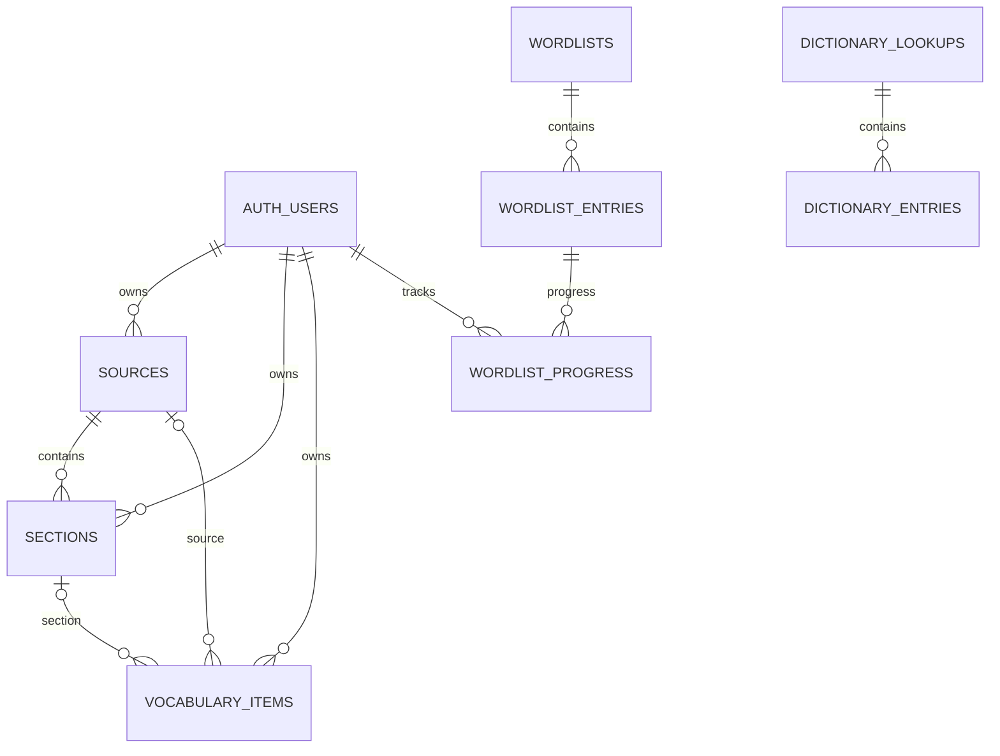

# D1 資料模型

Schema 定義在 [`apps/api/migrations/`](../apps/api/migrations/)。D1 migration 順序不可重排；已部署／套用的 migration 應保持不變，後續 schema 變更用新的序號檔。

## 關係概覽

Dictionary lookup/entry 關係以 `provider + term/lookup_term` 作應用層關聯，正規化 entries 表沒有資料庫 foreign key。

## 資料表職責

| Table                | 用途／關鍵欄位                                                                                                  |
| -------------------- | --------------------------------------------------------------------------------------------------------------- |
| `auth_users`         | Better Auth 使用者；含 `email`、`role`、封鎖欄位。                                                              |
| `auth_sessions`      | 登入 sessions、token、到期時間與 user 關聯。                                                                    |
| `auth_accounts`      | Credential provider 與密碼 hash 等 account 資料。                                                               |
| `auth_verifications` | Better Auth verification records。                                                                              |
| `sources`            | 使用者來源；`user_id` 所有權隔離。                                                                              |
| `sections`           | 必須隸屬一個 source；含可選排序 `position`。                                                                    |
| `vocabulary_items`   | 個人單字／片語、notes、狀態、可選 `source_id` 和 `section_id`。                                                 |
| `dictionary_lookups` | Provider lookup 的完整 JSON 回應和 30 天快取期限。                                                              |
| `dictionary_entries` | 從 Webster object entries 正規化的 headword、詞性、發音、音檔名稱、short definitions；另保留單筆 `entry_json`。 |
| `wordlists`          | 獨立詞表 metadata；不綁定使用者。                                                                               |
| `wordlist_entries`   | 詞表項目、POS、level、順序與正規化字串。                                                                        |
| `wordlist_progress`  | 每位使用者對詞表項目的 `learning`、`mastered` 或 `ignored` 狀態。                                               |
| `system_state`       | Bootstrap 一次性完成狀態。                                                                                      |

## 狀態與刪除語意

- `vocabulary_items.status`: `learning`、`mastered`、`archived`。
- 刪除使用者會 cascade 刪除其 source、section、vocabulary 和詞表進度。
- 刪除 source 會 cascade 刪除 sections；vocabulary 的 source/section foreign key 設為 null，保留單字在 root。
- 刪除 section 會把相關 vocabulary 的 `section_id` 設為 null。
- 詞表刪除會 cascade 詞表 entries 與對應 progress。

## 已知資料限制

CEEC 詞表尚未匯入；資料模型支援任意 wordlist，不將系統綁死於「7,000 words」。來源 PDF 標示 6,000 詞。dictionary response 會保留 provider 原始 JSON，以便適應 Merriam-Webster 多筆條目、拼字建議與深層欄位變化。
